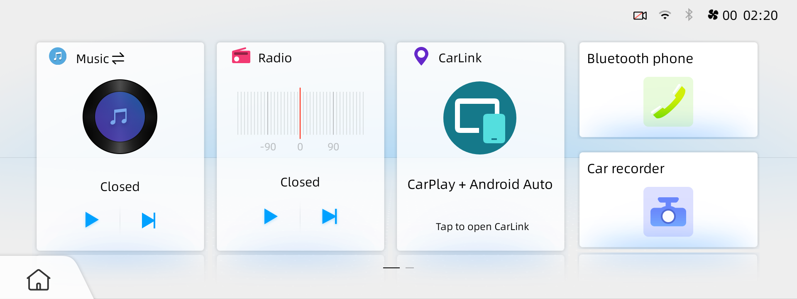
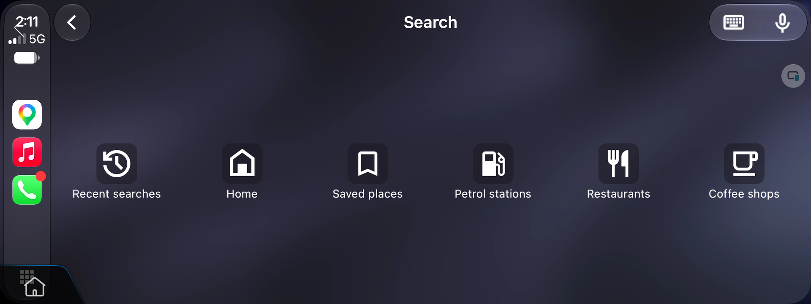
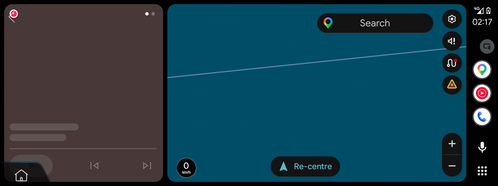

# Oshan X7 · CarPlay + Android Auto

Install CarLink with fullscreen projection and a large shortcut on the factory
Home screen. I built and tested this on my right-hand-drive 2025 Oshan X7 with a
1920 × 720 display.





## Supported head unit

The installer supports **F202_MCA, Android 9/API 28**, firmware
**F202RHD_D1_20241022162756**, MCU **F202RHD_20240722_1**. It checks the firmware,
factory apps and launcher before making changes. A matching model/year alone
is not enough. [Exact compatibility checks](docs/reference.md#exact-compatibility).

It uses the head unit's **existing factory root access (`su 0`)**. It does not
install root or flash firmware. Setup installs **CarLink 1.0.7 from its official
release**, configures its permissions and fullscreen layout, disables the factory
CarAuto app, and installs an update to the factory launcher. The factory launcher
APK stays on the system partition; Home/Back overlays remain available.

| Connection | My test results |
| --- | --- |
| iPhone CarPlay with a cable | Worked |
| iPhone wireless CarPlay | Worked |
| Android Auto with a cable | Worked |
| Android Auto wirelessly | Unreliable; I use a cable |

Both Android Auto and CarPlay worked fullscreen, and I tested the large card and
Home return. Microphone/Gemini recognition remains unresolved. Siri/call audio,
long sessions, repeated reconnects and cold ignition still need separate tests.
A car-side USB prompt may need a tap even with automatic permissions enabled.

**The complete fresh installation and restore sequence has been tested offline,
but still needs a full test on the car.** Individual components have been tested
on my car. [Test record and remaining checks](docs/verified-findings.md).

## Install with an AI agent

Use a local coding agent with terminal and internet access **on the laptop you
will connect to the car**. Paste this:

```text
Install this project on my Oshan X7:
https://github.com/teymurl3ng/oshan-x7-2025-android-auto

Download and extract the repository yourself, or reuse an existing copy without
overwriting its backups. Read AGENTS.md and follow its installation instructions.
Do the computer work yourself and guide me through physical steps one at a time.
```

The agent handles downloads, tools, commands and troubleshooting. You operate
car menus, connect cables, approve requests that need your attention and test
your phone. The instructions are in [AGENTS.md](AGENTS.md) and the
[agent runbook](docs/agent-setup.md).

Prefer to run the commands yourself? Follow [manual installation](docs/carlink-setup.md).

## Connect your phone

Finish installation and its Android reboot check with the laptop connected in
**Device模式**. After the command finishes, complete any available CarLink
welcome/car settings and check that the large card opens CarLink and Home returns
to the launcher. Leave phone pairing until the next steps.

1. Disconnect the laptop. In the car's `开发模式` menu, switch to **Host模式**.
   [Menu pictures and instructions](docs/car-menu.md#switch-to-host-for-your-phone).
2. Open the large **CarLink / CarPlay + Android Auto** card.
3. For wired AA or CarPlay, connect your unlocked phone with a data cable to the
   **regular charging/CarAuto USB port**. This is the port I used.
   For wireless CarPlay, enable the iPhone's Bluetooth and Wi-Fi and follow
   CarLink's pairing instructions.
4. Finish any remaining CarLink setup and review the phone's pairing/trust
   prompts. If a USB-access prompt appears on the car, check what it asks before
   responding.
5. Test fullscreen projection, touch, sound and Home return. Also check your
   usual radio/music, AC, phone and settings controls.

Phone USB debugging is not required. For connection problems, see
[troubleshooting](docs/usb-reliability.md).

## Keep your backup

Keep the repository and its private **`.oshan-x7`** folder, or the custom backup
folder used during installation. The installer reports its exact location.
Restore uses those original records to undo the changes made by your installation.

To use the laptop again, disconnect the phone, select **Device模式** and reconnect
the laptop. Follow the [recovery guide](docs/recovery.md). Recovery requires
responsive Android and authorized USB; a way back from Host mode with an unusable
launcher/menu has not been tested.

[More screenshots](docs/screenshots.md) · [Commands](docs/reference.md) ·
[Permissions](docs/permissions.md) · [Launcher details](docs/launcher.md) ·
[Contributing](CONTRIBUTING.md)

Thanks to [CarLink](https://github.com/F-e-n-y-x/CarLink) and its DiPlay/DiAuto
components. Installer code and documentation use [MIT](LICENSE); see
[third-party notices](THIRD_PARTY_NOTICES.md) for upstream credits and licenses.
