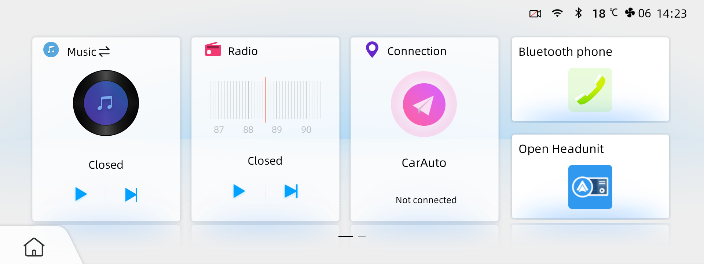
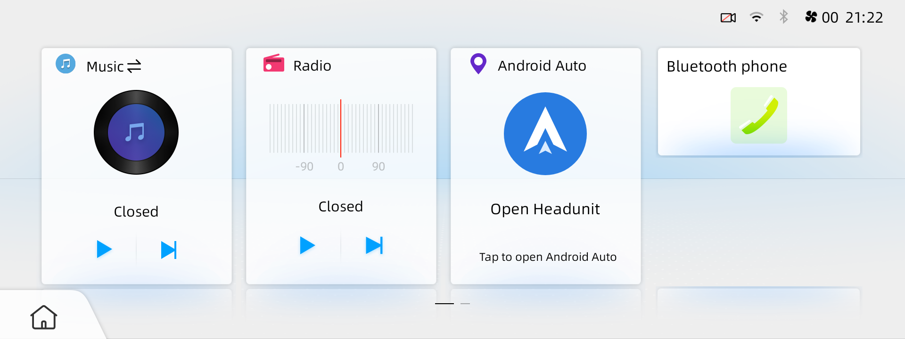
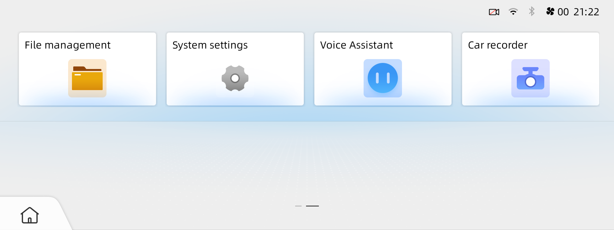
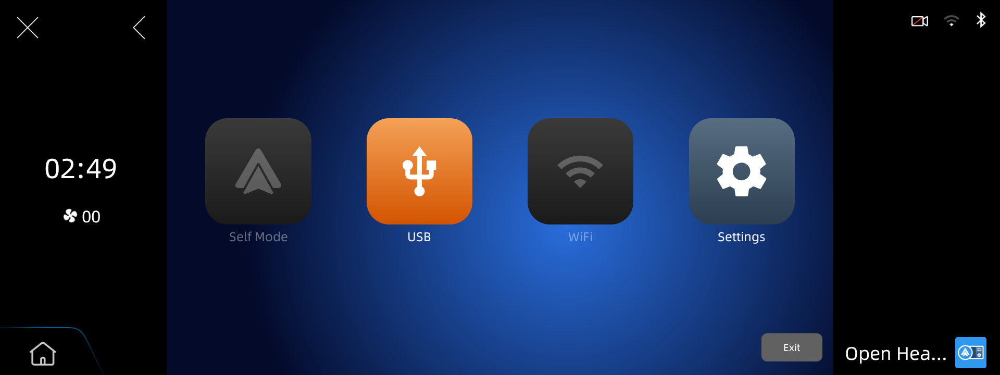
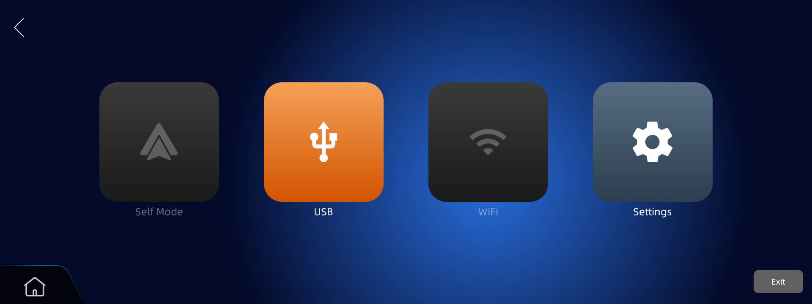

# Oshan X7 · Android Auto

Wired Android Auto works in full screen on my **2025 right-hand-drive Oshan X7**.
This project installs **Open Headunit 3.5.0**, disables the original CarAuto app,
saves the factory fullscreen setting, and gives the factory Home screen a large
**Android Auto** card. It also hides the duplicate small OpenHU and launcher icons.
Music, Radio, Bluetooth phone and the factory Home/Back controls keep their roles.

Only the exact **F202_MCA / Android 9 / F202RHD_D1_20241022162756** firmware is
supported. Setup checks the firmware and original/active launcher before writing.
The car already needs the tested root access; the script does not root it or
install Google services. Android Auto runs on the phone; Open Headunit receives it
on the car. The phone does not need USB debugging.

**Evidence:** the individual changes and exact launcher APK worked on my car,
including a normal Android reboot. **The combined v0.3 setup, automatic recovery
and reboot-check workflow still need a full live car test.** Passing software tests
is separate from seeing Android Auto work. [Evidence and limits](docs/verified-findings.md).

## Start here

Use a local AI agent on the **laptop that will connect to the car**, or follow the
same steps yourself. A browser-only chat cannot access your laptop's USB port.
Give your agent this:

```text
Set up wired Android Auto using this repo:
https://github.com/teymurl3ng/oshan-x7-2025-android-auto
Read AGENTS.md, README.md, docs/agent-setup.md and docs/car-menu.md first.
Prepare the laptop, check compatibility, then use the staged CLI and its unified
restore. Verify each step before continuing. Ask me for physical actions and
visible permission prompts. Keep machine checks and actual phone tests separate.
```

The agent handles downloads, laptop tools, checks and commands. You handle the
car's menus, cables, visible permission prompts and the actual phone test. Park
the car and keep the headunit powered throughout setup.

| Phase | Connected equipment | Car USB role |
| --- | --- | --- |
| Install and Android reboot check | Laptop → car by USB data cable; phone disconnected | **Device模式** |
| Use Android Auto | Android phone → car by USB data cable; laptop disconnected | **Host模式** |
| Restore or diagnose later | Phone disconnected; laptop → car again | **Device模式** |

Do not switch roles during a laptop command. The **video-recording USB port**
worked for phone projection on my car; the ordinary port kept disconnecting after
about 10–15 seconds. We have not recorded a complete physical port/cable map or
connector photos. Identify the actual connectors and use suitable data cables;
a charging-only cable will not carry ADB or Android Auto.

## 1. Prepare the laptop

Download and extract [the repository ZIP](https://github.com/teymurl3ng/oshan-x7-2025-android-auto/archive/refs/heads/main.zip),
or use an existing Git checkout. Keep an existing `.oshan-x7` folder: it contains
your original settings and recovery journal.

The agent should detect the OS, run Python to verify **3.10+**, and install missing
tools from the [trusted host sources](docs/agent-setup.md#2-find-or-install-python).
For manual setup, use the official [Windows](https://www.python.org/downloads/windows/)
or [macOS](https://www.python.org/downloads/macos/) Python installer, or your Linux
package manager. No Android Studio, Java or pip packages are needed.

Open a terminal in the extracted repository folder:

```sh
python3 prepare.py --json
```

On Windows PowerShell, use **`py -3` instead of `python3`** for every command here.
Preparation finds working ADB or downloads Google's official Platform Tools. It
returns the tool paths; use `--adb "path returned by preparation"` if needed.

## 2. Connect the laptop to the car

On the **car's built-in Phone dial pad**, enter **`*#*#888`**, tap **Call**, then
enter **`1111`**. Open **`开发模式` (Development mode)**, use **Settings** to enable
Android **USB debugging**, and leave the factory USB-role control showing
**`Device模式`**. [Exact Chinese labels, separate development-page PIN and pictures](docs/car-menu.md).

Connect the laptop with a USB data cable. If **Allow USB debugging** appears on
the car, accept it; choose “Always allow from this computer” only for your own
trusted laptop. Disconnect other phones from the laptop so the car is unambiguous.
The agent must resolve missing/unauthorized USB access before making car changes.
[Connection help](docs/reference.md#connection-help).

## 3. Check, install, and verify while the laptop stays connected

Run in the same folder, using the same ADB path/port and state directory:

```sh
python3 oshan_x7.py check --json
python3 oshan_x7.py setup --reboot-check --json
python3 oshan_x7.py status --json
```

Run setup only when **check passes**. Unknown firmware, launcher builds and
unsupported receiver versions stop setup; do not bypass the checks.

Setup saves the original state, then does one step at a time: check Home, install
and open the receiver, disable CarAuto, save fullscreen, install/open the exact
launcher update, and read everything back. It checks process stability, foreground
activities and fresh crash/ANR events between steps. The launcher is rebuilt from
the hash-checked factory APK and bundled patch; the original system APK stays intact.

Keep watching the car. Accept Open Headunit's visible permissions and complete its
onboarding: choose **USB**, **right-hand drive**, and landscape. My receiver setup
used about **10 inches, 180 DPI and phone GPS**. If the command reports
**`waiting_for_permissions`** (exit 3), accept the visible car prompt and rerun
the **same setup command**. Do not switch to Host or create a new backup directory.
An unrecognized blocking screen needs inspection; the script does not silently
approve permissions.

`--reboot-check` performs a **normal Android reboot** while the laptop remains
connected, checks a new boot identity and the saved state, and opens Home/OpenHU
again. This is not an ignition/power-off test. A completed matching run is a no-op;
a run without this option asks you to add the reboot check before the phone handoff.

If a step fails, setup attempts the same guarded recovery used by `restore`.
If USB is lost, it keeps the journal so recovery can continue after reconnection.
Do not proceed to the phone test while recovery or permissions are pending.
[Recovery and its limits](docs/recovery.md).

Before disconnecting, check that the large Android Auto card opens OpenHU, Home
returns to the edited launcher, unwanted duplicate icons are absent, and your
usual radio/music, AC, phone and settings controls still respond. These human
checks add evidence that process health alone cannot provide.

## 4. Connect the phone and test Android Auto

1. After setup reports **`phone_handoff`**, disconnect the laptop.
2. In the factory **`开发模式`** page, select **`Host模式`**.
3. Connect the Android phone directly to the **video-recording USB port** with a
   data cable. Open the large **Android Auto** card and choose USB in Open Headunit.
4. On the **car**, accept Open Headunit's USB-device/access prompt. If it offers
   an “always use” option for this receiver, select it. On the **phone**, unlock
   it and accept Android Auto setup/permission prompts. Exact wording varies.
5. Test Maps, sound and touch. Press factory Home, reopen the large Android Auto
   card, then disconnect/reconnect once. Confirm your usual native controls work.

Repeated USB prompts are not proof of a permission problem: on my car they also
accompanied an unstable port. Confirm Host mode, data cable and recording port
before repeatedly changing settings. If the screen stays black or reconnects,
[return to USB Device mode for diagnosis](docs/recovery.md).

OpenHU **Settings → General → Show toast messages → Off → Save** removed the large
routine reconnect popup on my car. This is an optional visible app setting, left
alone by the CLI and its restore. Forced error messages can still appear.

**Known limits:** Gemini/microphone recognition remains unresolved, including the
native assistant. Wireless has not been retested since disabling CarAuto. The
small factory Home/Back overlays remain; Home can cover some AA controls. A cold
ignition cycle and every possible vehicle function have not been qualified.

## Android Auto on the factory Home screen

The factory Home screen had a large CarAuto card even after Open Headunit was
installed. Opening AA meant using its smaller app tile instead. This update
gives that large card to Android Auto, removes the redundant small OpenHU tile,
and hides the launcher/test-launcher entries from the app menu. It keeps the
existing Music, Radio and Bluetooth layout, including the factory Home overlay.

**Before:** the original Connection / CarAuto card, with OpenHU as a small tile.



**After:** the large Android Auto card opens Open Headunit directly. The small
duplicate is gone. This capture was taken after a normal Android reboot.



The app menu also keeps its native entries without a second launcher icon:



These are actual launcher captures from my car, not pictures of an active AA
session. I separately tested the large card, Home return, usual native controls
and wired AA. The unified v0.3 installer still needs its own full live setup/restore
test. [Launcher details, checks and recovery](docs/launcher.md).

## Screenshots from my car

These are the same Open Headunit main screen before and after I changed the
factory fullscreen setting.

**Before:** the app used the middle 1280×720, with the factory panels taking up
both sides of the 1920×720 display.



**After:** the app fills the full 1920×720 width. The small factory Home button
still sits over the bottom-left corner.



These captures show Open Headunit's main screen. I checked Android Auto's full
width separately with my phone connected.

## Undo the setup

Use the **same laptop, repository and `.oshan-x7` folder** (or the same custom
`--state-dir`). Disconnect the phone, select **Device模式**, connect the laptop,
and run:

```sh
python3 oshan_x7.py restore --json
```

This is one restore for all changes owned by that setup cycle: launcher update,
fullscreen behavior, CarAuto state, and a newly installed receiver. Preexisting
apps remain. Manually chosen receiver/phone settings remain outside this journal.
A partial restore reports what is blocked and can be retried. Keep the backup.
[Full recovery guide](docs/recovery.md).

Recovery needs responsive Android, package management and authorized USB ADB. No
USB-only script can repair a unit that cannot expose ADB. After the laptop is
unplugged there is no background crash watcher. Regaining Device mode from Host
with an unusable launcher has **not** been qualified; do not assume an emergency
menu or hardware recovery route exists. [Pending car tests](docs/testing.md).

## Project guides

| Guide | Purpose |
| --- | --- |
| [Agent workflow](docs/agent-setup.md) | Laptop preparation, stage decisions and what to verify |
| [Car screens](docs/car-menu.md) | Exact menus, Chinese labels, roles, prompts and cables |
| [Recovery](docs/recovery.md) | One restore, interrupted runs and recovery boundaries |
| [Reference](docs/reference.md) | Compatibility, CLI options and machine-readable states |
| [Launcher](docs/launcher.md) | Pinned patch, source changes and ownership |
| [Verified findings](docs/verified-findings.md) | Live evidence, owner reports, code findings and unknowns |
| [Testing](docs/testing.md) | Offline checks and the outstanding live test |

Credit to **[Open Headunit](https://github.com/andreknieriem/open-headunit)** and its
maintainers. The installer downloads their official 3.5.0/code119 APK and verifies
its checksum. Factory/modified APKs, signing keys and private backups are not
published. Only the pinned launcher patch and reviewed screenshots are included.
I'm not affiliated with Changan or Google. Installer code and documentation use
the [MIT license](LICENSE). [Contributing](CONTRIBUTING.md).
