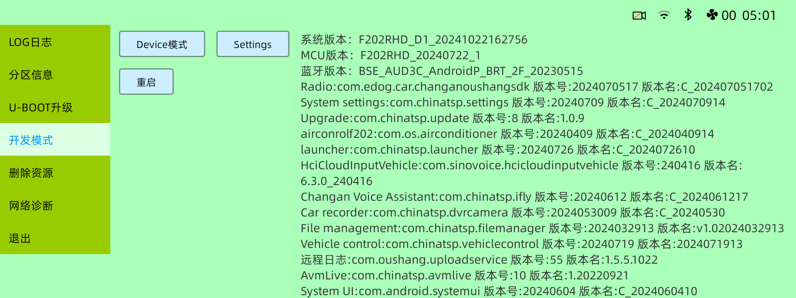

# Open the car's developer settings

These are the menus on **my 2025 Oshan X7 / F202_MCA**. I've included my screenshots
and the Chinese labels so you can find the right controls without tapping around
blindly. Park the car and keep the headunit powered while doing this.
Enter the dialer code on the **car**, not your phone.

## 1. Open the factory menu

1. Return to the car's normal home screen.
2. Open its built-in **Phone / Bluetooth phone** app and show the **dial pad**.
3. Enter the following exactly, with no spaces:

   ```text
   *#*#888
   ```

4. Tap **Call** (the handset button).
5. At the black numeric factory PIN screen, enter:

   ```text
   1111
   ```

   It opens the customer factory menu after the fourth digit. You don't need
   to look for an Enter button on this keypad.

Here's the **PIN screen from my car**:


`退出` means **Exit**; `删除` means **Delete/backspace**.

## 2. Open the development page

1. In the factory menu's left-hand list, select **`开发模式`**
   (**Development mode**). It is the fourth entry in the captured F202 customer-menu
   list, following `LOG日志`, `分区信息`, and `U-BOOT升级`. Select only `开发模式`.
2. If it shows another PIN keypad, this is a **second, separate gate**. The saved
   factory APK's default for that development page is **`3821`**. This value was
   checked against the saved app's code; **I haven't re-entered it on the car to
   test it**. A previously changed password can override that default. If it's
   rejected, stop rather than trying random codes.
3. The page has a USB-role button on the left, showing
   **`Device模式`** or **`Host模式`**, and a **Settings** button beside it.
   Tap **Settings** to open Android's settings app.

**Here's the unlocked menu and USB-role page from my car, captured on 2026-10-26:**



- **`开发模式`** is highlighted in blue in the left-hand menu.
- **`Device模式`**, at the top of the main panel, shows the current USB role.
  Leave it in this role while the laptop is connected. The USB check made with
  this screenshot also returned `OTG_MODE=1`.
- **Settings**, immediately to its right, opens Android settings.
- **`重启`** below the role control means **Reboot**; it is not needed for this step.

I had this page open when the screenshot was taken. It shows where the controls
are, but it isn't another test of the PINs. The capture didn't change the USB role.

## 3. Enable USB debugging in Android settings

1. In Android settings, look for **System → Advanced → Developer options**.
   Chinese Android labels may read **`系统` → `高级` → `开发者选项`**.
2. If Developer options is hidden, open **About device / About tablet** and tap
   **Build number** seven times, then return to System. This is Android's standard
   procedure; the exact About page name depends on the settings build.
3. Turn on Developer options if its master switch is off, then enable
   **USB debugging / `USB 调试`**. Accept its confirmation.

The **factory menu** and Android's **Developer options** are separate screens.
The factory `开发模式` page is where the saved app exposes the USB role;
Android settings is where USB debugging is enabled.

## 4. Select Device mode for the laptop

1. Return to the factory menu and select **`开发模式`** (**Development mode**).
2. Unlock that page if prompted, as described in step 2 above.
3. On that page, the USB-role control displays **`Device模式`** or **`Host模式`**.
   It is a toggle: tap it only if needed, until it displays **`Device模式`**.
4. Connect the laptop with a suitable USB data cable. Accept **Allow USB debugging**
   if the car asks. The agent can now verify that ADB sees an authorized USB device.

The saved factory code reports **Device = 1**, **Host = 2** and updates the button
label to show the current role. There may be a short delay while the role changes.
Do not toggle it repeatedly while a setup command is running.

If debugging is enabled but the laptop still sees nothing, the agent should check
the cable, role, host-side permissions/drivers, and ADB server. Android's
**Default USB configuration → File transfer** may also be relevant if that option
is available. Do not turn on wireless ADB for this workflow.

## Switch to Host for the phone

After the agent or setup command finishes:

1. Disconnect the laptop from the car.
2. Return to **Phone → `*#*#888` → Call → `1111`** if the factory menu was closed.
3. Open **`开发模式`** and unlock that page if prompted, as described above.
4. Tap the USB-role toggle until it displays **`Host模式`**.
5. Open Open Headunit, choose USB, and connect the phone directly to the car.

For restore or later ADB work, disconnect the phone and change the role back to
**`Device模式`** before connecting the laptop.

## Chinese label reference

| On-screen text | Meaning / purpose | Evidence |
| --- | --- | --- |
| `工厂设置` | Factory settings | Saved factory app label |
| `Settings` | Opens Android settings | Actual unlocked-page capture and saved click handler |
| `开发模式` | Factory development page; USB role control | Actual unlocked-menu capture and saved implementation |
| `Device模式` | USB Device mode: laptop debugging | Actual capture and live `OTG_MODE=1` read-back |
| `Host模式` | USB Host mode: phone projection | Saved strings and role callback |
| `重启` | Reboot | Actual unlocked-page capture |
| `退出` | Exit | Actual PIN-screen capture |
| `删除` | Delete/backspace | Actual PIN-screen capture |
| `开发者选项` | Android Developer options | Standard Android translation; no local screen capture |
| `USB 调试` | USB debugging | Standard Android translation; no local screen capture |

## Where these instructions came from

- **What worked on my car:** car Phone dialer → `*#*#888` → Call. The `1111` PIN
  worked during the original setup and was also matched to the saved
  `MainActivity` implementation, which opens `FactoryCustomerActivity`.
- **Saved factory app:** labels, Android settings launch, the second development
  page's default PIN, and the USB-role toggle were inspected offline. Its APK is
  not distributed. The development-page default PIN remains code evidence.
- **Live capture, 2026-10-26:** the connected headunit reported `F202_MCA` and
  `F202RHD_D1_20241022162756`. A read-only USB capture shows the unlocked factory
  list, selected development page, Device-mode control, and Settings button.
  `OTG_MODE=1` was read back; no UI controls were pressed or settings changed.
- [An Oshan X7 Plus guide](https://hackchan.ru/oshan/oshan-x7/) independently lists
  the same dialer code, `开发模式`, and the separate development-page PIN `3821`.
  Its **outer** PIN differs; the one that worked on my unit is `1111`.
- [A first-hand Changan UNI-K project](https://github.com/ksergey/changan_uni_k_android_fun#инженерное-меню)
  documents the same dialer entry on another model. It is corroboration of the
  entry sequence, not evidence of Oshan firmware compatibility or shared passwords.
- [Android's official Developer options guide](https://developer.android.com/studio/debug/dev-options)
  explains enabling Developer options and USB debugging.

I've included the PIN screen and unlocked Device-mode page above. I haven't added
a separate Host-mode or Android USB-debugging screenshot yet. I used Host mode for
the earlier wired tests, and its behavior also matches the saved app's code. If
your screen looks different, check it with your agent before going further; don't
borrow engineering codes from another model.
