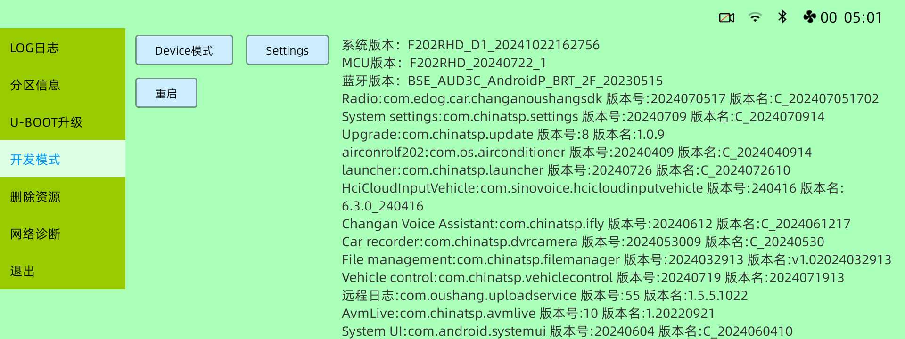

# Open the car's developer settings

These are the menus on my **2025 Oshan X7 / F202_MCA**. Park the car and keep the
head unit powered. Enter the dialer code on the **car**, not your phone.
If authorized USB already works, you do not need to repeat these steps.

## 1. Open the factory menu

1. From the car's Home screen, open **Phone / Bluetooth phone** and its dial pad.
2. Enter **`*#*#888`**, then tap **Call**.
3. At the black PIN keypad, enter **`1111`**. The menu opens after the fourth
   digit; there is no Enter button to press.

`退出` means **Exit**; `删除` means **Delete/backspace**.

## 2. Open the development page

Select **`开发模式` (Development mode)** in the factory menu's left-hand list.
It is the fourth entry in this screenshot. Select it by its label.

If another PIN keypad appears, this is a separate gate. The factory app's default
is **`3821`**, found by inspecting its code. **I have not tested entering this
second PIN on the car.** A changed password can override the default. Stop if it
is rejected rather than trying other codes.

The control showing **Device模式** or **Host模式** displays the current USB role.
**Settings** beside it opens Android settings. **`重启`** below it means Reboot;
you do not need that control here.

## 3. Enable USB debugging

1. Tap **Settings** and look for **System → Advanced → Developer options**
   (`系统` → `高级` → `开发者选项`).
2. If Developer options is hidden, open **About device / About tablet** and tap
   **Build number** seven times, then return to System. The exact About label
   can vary with the settings build.
3. Turn on Developer options if needed, then enable **USB debugging / `USB 调试`**
   and accept its confirmation.

Android Developer options enables debugging. The factory development page
controls the USB role; they are separate screens.

## 4. Select Device mode for the laptop

1. Return to the factory **`开发模式`** page and unlock it if prompted.
2. Tap the USB-role toggle only if necessary so it displays **Device模式**.
3. Connect the laptop using a USB data cable. Accept **Allow USB debugging** for
   this trusted laptop if shown. “Always allow” is optional for that computer.

Keep Device mode selected until installation and its Android reboot check finish.
The role may take a moment to change; do not toggle it repeatedly.
If the laptop cannot connect, use [USB troubleshooting](usb-reliability.md#laptop-cannot-connect).

## Switch to Host for your phone

After setup and reboot checks finish, complete available CarLink welcome/car
settings and check the large card/Home while the laptop is still connected.
Then:

1. Disconnect the laptop.
2. If the factory menu is closed, reopen **Phone → `*#*#888` → Call → `1111`**.
3. Select **`开发模式`**, unlocking the separate gate if prompted.
4. Switch the role so the control displays **Host模式**.
5. Open CarLink and follow [Connect your phone](../README.md#connect-your-phone).
   For a cable connection, use the regular charging/CarAuto USB port.

To return to laptop diagnostics or restore, disconnect the phone, select
**Device模式**, then reconnect the laptop. If the launcher/menu is unusable in
Host mode, a way back to Device mode has not been tested. [Recovery limits](recovery.md#access-limits).

## Prompts and screens

| Prompt | Screen | What to do |
| --- | --- | --- |
| Factory PIN | Car | Use the documented code for that gate; `1111` and the separate default `3821` are different. |
| Enable USB debugging | Car Android settings | Enable it for laptop access. |
| Allow USB debugging / computer fingerprint | Car after laptop connection | Authorize this trusted laptop; the installer must then see an authorized USB device. |
| Tool/driver installation approval | Laptop | Approve the prepared trusted installer if the OS requires it. |
| CarLink welcome/car settings | Car | Complete available setup after the installer finishes; inspect the actual options. |
| Unexpected runtime/special-access request | Car | Keep laptop access and inspect why automatic permissions did not cover it. |
| USB access or default-app choice | Car after phone connection | Review the displayed request. The automatic service may not handle it. |
| AA/CarPlay pairing or trust | Phone | Unlock your phone and review its prompts. Phone debugging is unnecessary. |

Prompt text varies by software and phone. If a screen differs, inspect it before
proceeding. A repeatedly disappearing USB prompt can also indicate a connection
reset; check the cable and role.

## Menu evidence

I used the dialer code and outer PIN `1111`. The unlocked-menu screenshot was
captured on 2026-10-26; the USB property read back as `OTG_MODE=1`. The factory app
code maps Device to `1` and Host to `2` and supplies the separate default PIN.
I used Host mode for wired projection, but have not included a Host-mode or
Android debugging screenshot. The Android settings directions follow
[Android's Developer options guide](https://developer.android.com/studio/debug/dev-options).
