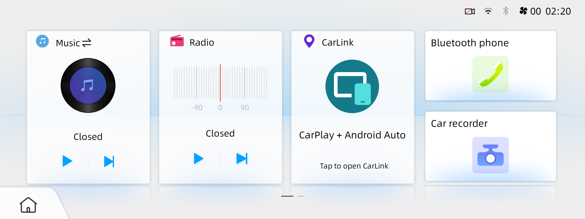

# Factory Home card for CarLink

Setup installs a signed update to the factory launcher under `/data/app`. The
original APK remains on the system partition. The large card reads **CarLink /
CarPlay + Android Auto** and opens
`com.carlink.app/com.carlink.app.ui.HomeActivity`. Navigation shortcuts target
the same app; redundant projection/launcher entries are hidden from the app menu.

Home/Back overlays remain, and the Bluetooth card retains its size. Factory
radio/music and vehicle controls remain accessible; their complete behavior
still needs the checks listed in [the test record](verified-findings.md).
This update does not fix microphone routing.

## Artifact and source changes

The update is 8,274,207 bytes with SHA-256
`ffc81db01bb7d1645b6a9efd9d23960cafd6b671ba51b88d3816794597b30285`.
The factory base, output hash, system/shared UID 1000, version 20240726 and default
Home must match. [All artifact pins](reference.md#artifact-pins).

The installer applies [one factory-to-CarLink binary delta](../patches/f202-launcher-carlink.bsdiff)
to the verified factory APK. The readable source patches record the development
steps, rather than a single factory-to-final source diff:

1. [Factory to Open Headunit](../patches/launcher-openhu-source.patch): replaces
   CarAuto navigation/launch handling, changes labels/icon, removes its injected
   menu entries and connection receiver (including its manifest declaration).
2. [Menu cleanup](../patches/launcher-menu-cleanup-source.patch): filters redundant
   app entries.
3. [Open Headunit to CarLink](../patches/launcher-carlink-source.patch): changes
   app targets, labels/icon and filtering to CarLink.

These are source-comparison records, not instructions to install the intermediate
apps or a guarantee that sequentially applying text patches rebuilds the signed
APK. In particular, the final incremental patch has no manifest change; the
complete change from factory does. Only reconstruction with the exact binary
output hash is accepted by the installer. Full APKs and signing inputs stay private.

## Maintainer patch tool

`tools/make_launcher_patch.py` regenerates an already recorded binary delta from
local factory/modified APKs, requiring exact input/output hashes. It uses CarLink
by default; `--profile openhu` selects the older recovery artifact. Supply
`--factory`, `--modified`, `--output` and, if needed, `--bsdiff`. This tool does
not create or sign a new launcher build and does not access the car.

Do not change the launcher binary or pins just to rename internal historical
symbols. New builds require inspection and testing on the exact supported unit.

## Installation and rollback

Setup records the update before installation and checks launcher identity,
Home/SystemUI health and the Android reboot. Restore removes only an exact update
added by that installation, preserving launcher data and a preexisting update.
It uses `pm uninstall -k` **without `--user`** for the system-app update rollback.
Use the guarded CLI; never remove or disable Home for a single user.
[Recovery](recovery.md).
