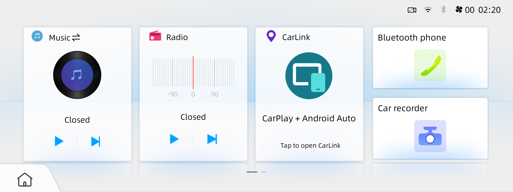
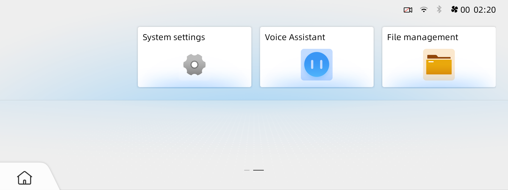
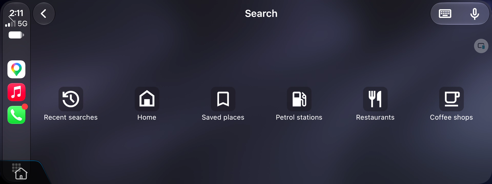
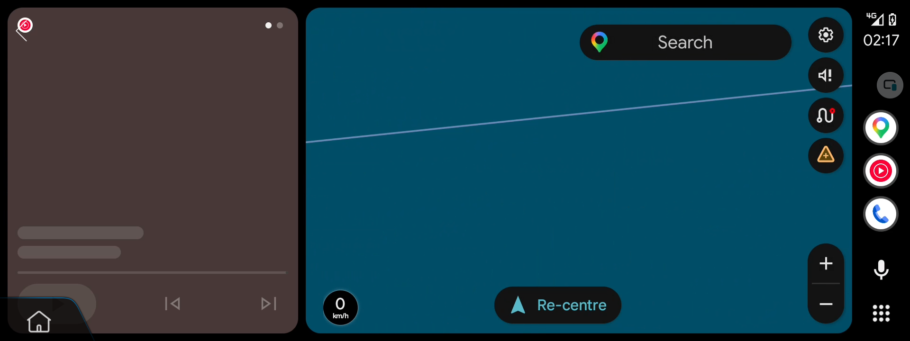
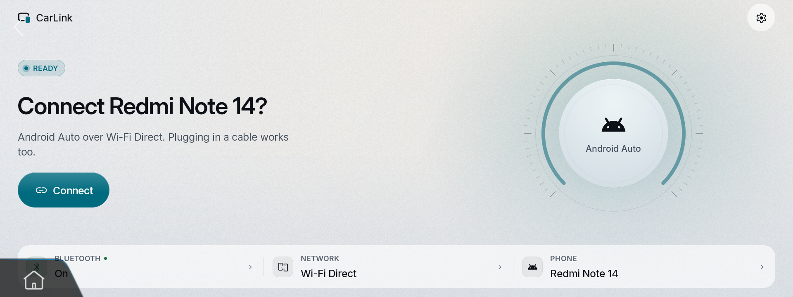

# Screenshots from my car

CarLink captures from **2026-11-02**, at the native **1920 × 720** resolution.
See the [test record](verified-findings.md#screenshot-provenance) for capture
provenance and the limits of what these pictures demonstrate.

## Factory Home

The large **CarLink / CarPlay + Android Auto** card opens CarLink. Music, Radio,
Bluetooth phone and recorder cards remain on Home.

## App menu

System settings, Voice Assistant and File management remain available. Redundant
projection/launcher entries are hidden.

## Fullscreen CarPlay

CarPlay Search fills the display. The small factory Home/Back overlays remain,
including their overlap with projection controls in the lower-left corner.

## Fullscreen Android Auto

This dashboard frame was captured before map labels and media content loaded.
The factory overlays remain visible.

## CarLink Home

CarLink's own connection screen also fills the display. This picture shows the
app before phone projection starts.

[Capture manifest](images/carlink-reference.json) · [Factory menu pictures](car-menu.md).
